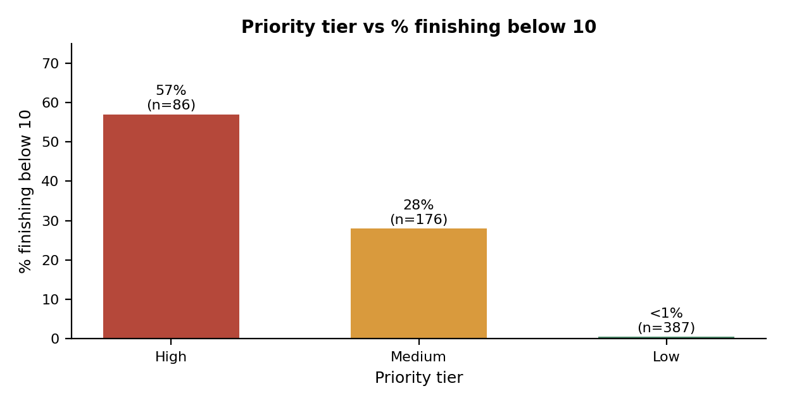
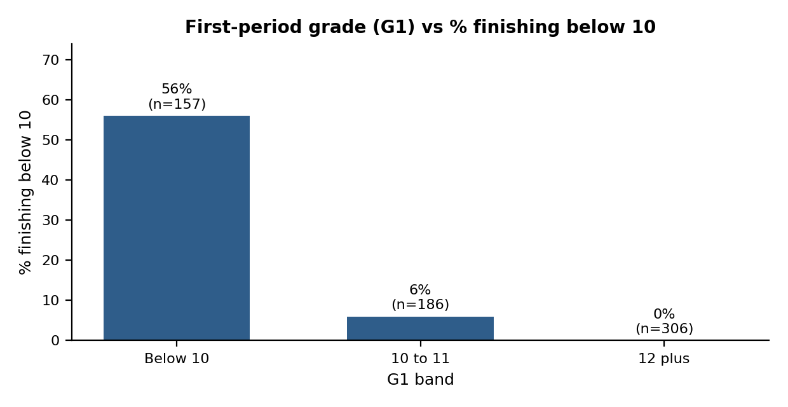
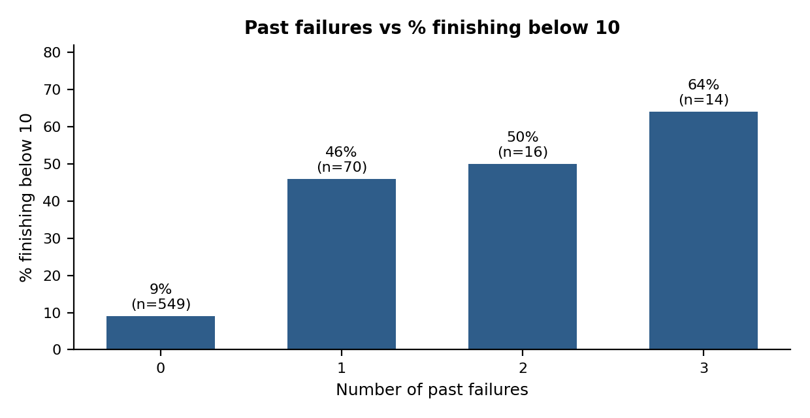
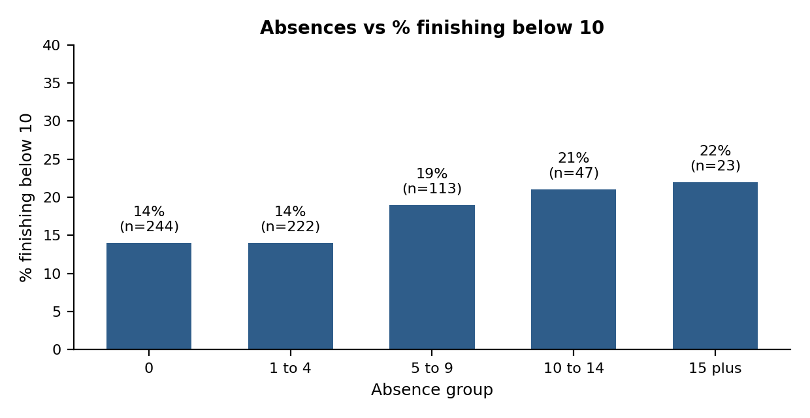

# Learner Support Prioritisation (Excel)

A transparent, rule-based way to decide which learners may benefit from a supportive check-in first, built end to end in Excel on a public student performance dataset. The focus is fairness: no profiling by demographics or family background, and no use of final results to make early decisions.

**Status:** all four milestones complete.

## The problem

A programme team wants to move from general learner-support conversations to a structured way of deciding where facilitator attention is needed first. They are worried about algorithmic bias and stereotyping, so the approach must be simple enough for facilitators to review and use responsibly.

## Result in brief

A points rule built from four early signals sorts 649 learners into three tiers. Final grades were used only to check the rule, never to build it.



| Tier | Learners | % finishing below 10 |
|---|---|---|
| High | 86 | 57% |
| Medium | 176 | 28% |
| Low | 387 | under 1% |

Flagging High and Medium catches 98 of the 100 learners who finished below 10, but about 6 in 10 of those flagged did not, so every flag is a prompt for a supportive conversation, not a verdict.

## Approach

| Milestone | What it covers | Document |
|---|---|---|
| 1.1 Framing and ethics | Problem, stakeholder, what "support priority" means, and which variables to use or exclude | [docs/milestone_1_1_framing_and_ethics.md](docs/milestone_1_1_framing_and_ethics.md) |
| 1.2 Data preparation and exploration | Cleaning, grade leakage, patterns in prior grades, failures and absences | [docs/milestone_1_2_data_prep_and_eda.md](docs/milestone_1_2_data_prep_and_eda.md) |
| 2.1 Prioritisation logic | The points rule, tiers, and checks against final grades | [docs/milestone_2_1_prioritisation_logic.md](docs/milestone_2_1_prioritisation_logic.md) |
| 2.2 Final delivery | Executive summary, fairness and sensitivity checks, recommendations | [docs/milestone_2_2_final_delivery.md](docs/milestone_2_2_final_delivery.md) |

## The rule

| Signal | Rule | Points |
|---|---|---|
| First-period grade (G1) | below 10 / 10 to 11 | 2 / 1 |
| Past failures | 1 or more | 2 |
| Study time | lowest category | 1 |
| Absences | 10 or more | 1 |

**Tiers:** High = 4 or more points, Medium = 2 to 3, Low = 0 to 1.

## Key findings



G1 is the strongest early signal: 56% of learners with G1 below 10 finished below 10, versus 6% for G1 of 10 to 11 and none for 12 or more.



About 49% of learners with one or more past failures finished below 10, versus 9% with none.



Absences show only a weak link (14% rising to 22%), so they prompt a conversation rather than drive a score.

## Handling grade leakage

The goal is early support, so only information known before the decision is used.

| Grade | Treatment |
|---|---|
| G1 | Used as the early academic signal |
| G2 | Used only if the decision is made after period 2 |
| G3 | Never used to prioritise; used only to check findings afterwards |

## Ethics and checks

- **Not used in the rule:** sex, age, address, parents' education and jobs, romantic status, alcohol use, and other family and lifestyle fields. They describe who a learner is, not what support could change.
- **Fairness audit:** the rule still flags some groups more often (for example boys, rural learners and one of the two schools), mirroring real gaps in outcomes. The data cannot say why, so flags must never label a group.
- **Sensitivity check:** removing absences barely changes coverage, and equal weights catch fewer low finishers, so the weighting is sensible.
- **Human oversight:** facilitators review every flag and can override it. The purpose is support, not labelling or exclusion.

## Limitations

- These are associations in group data, not causes, and cannot explain why an individual learner struggles.
- The rule was built and tested on the same data, so real performance on new learners is likely lower.
- The dataset is public and from another context, so results may not transfer to the programme's learners.
- Study time and absences are approximate or self-reported, and grades can miss barriers that scores do not show.

## Repository structure

```
├── README.md
├── data/        source data (see credit below)
├── workbook/    Excel workbooks for each milestone
├── docs/        one write-up per milestone
└── images/      charts used in the docs
```

## Tools

Built entirely in Excel (COUNTIF, AVERAGEIF, COUNTIFS, SUMPRODUCT, CORREL, IF rules and charts). I plan to repeat the same analysis in SQL, Power BI and Python.

## Data source

Student performance data (Portuguese course) from the UCI Machine Learning Repository, created by P. Cortez and A. Silva (2008). Please check the repository page for the current licence and citation before reusing the data.

## Author

Thavhiwa Khuliso John
