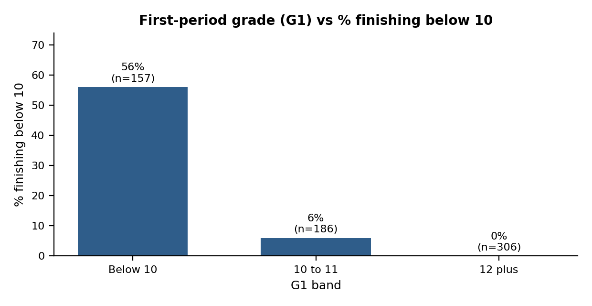
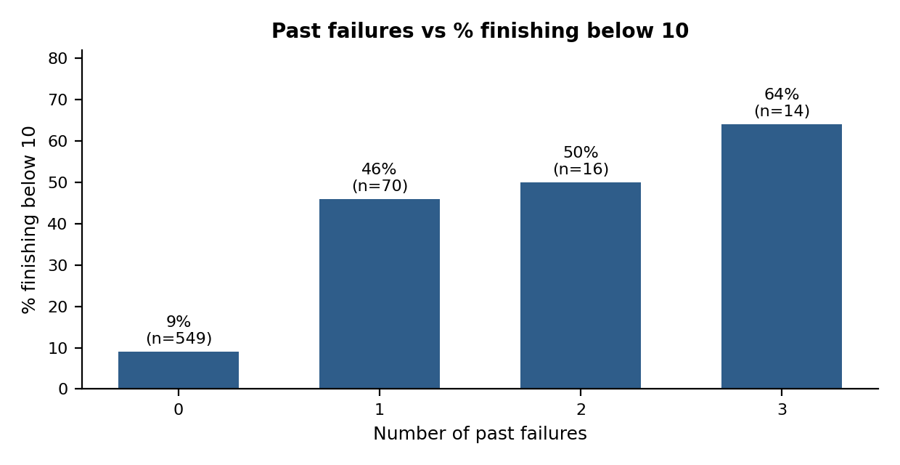
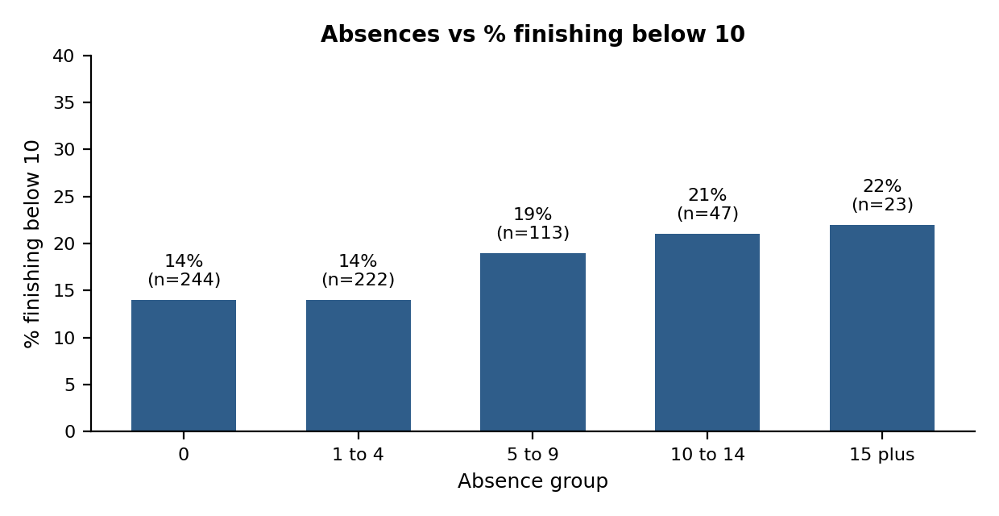

# Milestone 1.2: Data Preparation and Exploratory Analysis

**Author:** Thavhiwa Khuliso John
**Dataset:** public student performance data (Portuguese course), 649 learners, 33 columns. Not internal programme data.

## 1. Purpose

Prepare the data and explore which early signals relate to low final results, using only variables cleared in Milestone 1.1. "Below 10" means a final grade (G3) under 10 out of 20, which is an assumption for a below-pass result.

## 2. Data preparation

The source file (`student-por.csv`) is semicolon-delimited. It was loaded with the delimiter set to semicolon, giving 649 rows and 33 columns, matching the brief. All analysis was done on a working copy so the original data stayed unchanged.

| Check | Result | Decision |
|---|---|---|
| Rows and columns | 649 / 33 | Matches the brief |
| Missing values | 0 | No imputation needed |
| Duplicate rows | 0 | Nothing removed |
| Absences | 0 to 32, right-skewed | Kept (real values); grouped into bands |
| Zero grades | G1: 1, G2: 7, G3: 15 | Flagged, not removed: a zero may mean non-completion |

Helper fields added on the working copy: a flag for a final grade below 10 (used only to check patterns), an absence band, and a G1 band.

## 3. Handling grades (grade leakage)

The goal is early support, so only information available before the decision guides prioritisation.

| Grade | Treatment | Reason |
|---|---|---|
| G1 | Allowed as the early academic signal | Earliest available result |
| G2 | Allowed only if the decision is made after period 2 | Correlation with G3 is 0.92, so it would dominate any rule |
| G3 | Never used to prioritise; used only to check findings | It is the final outcome |

## 4. Exploratory findings

Overall, 100 of 649 learners (15%) finished below 10.

**Figure 1.** Learners with G1 below 10 were far more likely to finish below 10 (56%, versus 6% for G1 of 10 to 11 and none for 12 or more).

**Figure 2.** Even one past failure was linked to a much higher rate of low final grades (46% to 64%, versus 9% with none). The three-failure group is small (14 learners).

**Figure 3.** The link with absences is weak: rates rise gradually from 14% to 22%, and the highest groups are small. Absences are a prompt to ask, not a score.

### Supporting signals

| Signal | Group | % finishing below 10 |
|---|---|---|
| Study time (self-reported) | 1 / 2 / 3 / 4 | 24% / 13% / 7% / 6% |
| School support | Yes / No | 12% / 16% |

Learners already receiving school support did not do worse, so support status is used to coordinate help, never as a penalty.

### Correlation with the final grade (G3)

| Measure | Correlation |
|---|---|
| G1 | 0.83 |
| G2 | 0.92 |
| Past failures | -0.39 |
| Study time | 0.25 |
| Absences | -0.09 |

## 5. Timing check: G1 or G2?

| Rule | Flagged | Caught | % of low finishers caught | % of flagged who finished low |
|---|---|---|---|---|
| G1 below 10 | 157 | 88 | 88% | 56% |
| G2 below 10 | 145 | 89 | 89% | 61% |
| G1 of 10 or less | 252 | 98 | 98% | 39% |

G1 identifies nearly as many eventual low finishers as G2 while being available a full period earlier. Widening the G1 rule catches more learners but flags many more, raising facilitator workload. Many flagged learners still finish above 10, so a flag must lead to a conversation, never a conclusion.

## 6. Limitations

- These are associations in group data, not causes, and say nothing certain about any individual.
- The dataset is public and from another context, so results may not transfer.
- Study time and absences are approximate or self-reported; absences have many possible causes.
- Small groups give unstable percentages.
- Grades can miss barriers that scores do not show.

## 7. Next step

Turn these findings into a simple, transparent tier rule (Milestone 2.1).

**Workbook sheets:** `Data_Prep_Note`, `Working_Data`, `EDA_Tables_Charts`, `Timing_Check`, `Findings_Limitations`
