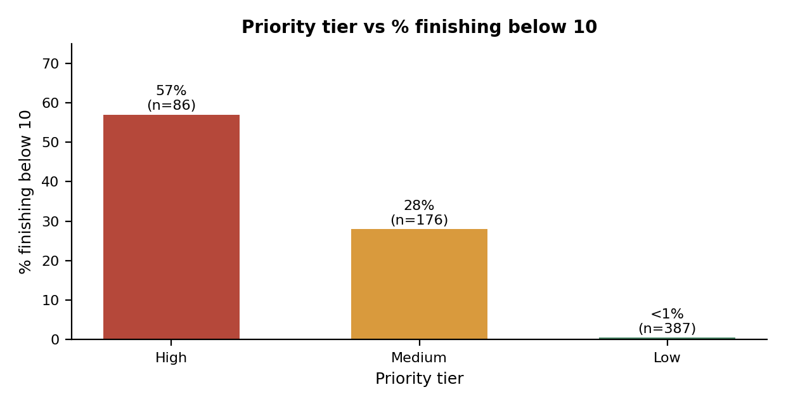

# Milestone 2.1: Prioritisation Logic

**Author:** Thavhiwa Khuliso John

## 1. Goal

Turn the Milestone 1.2 findings into a simple, transparent points rule that sorts learners into High, Medium or Low priority for a supportive check-in. The rule is a decision aid for facilitators, not a prediction model.

## 2. The rule

| Signal | Rule | Points | Why it is used |
|---|---|---|---|
| G1 | below 10 | 2 | Strongest early signal: 56% of these learners finished below 10 |
| G1 | 10 to 11 | 1 | Borderline: 6% finished below 10 |
| Past failures | 1 or more | 2 | 49% finished below 10, versus 9% with none |
| Study time | lowest category | 1 | 24% finished below 10, versus 6% to 13% in higher categories |
| Absences | 10 or more | 1 | Weak link, so only 1 point; acts as a conversation prompt |

| Tier | Total points | Suggested facilitator action |
|---|---|---|
| High | 4 or more | Check in first: a supportive conversation, then offer tutoring or a study group |
| Medium | 2 to 3 | Check in as capacity allows and keep an eye on progress |
| Low | 0 to 1 | No extra action needed; routine support |

**Deliberately not used:** sex, age, address, parents' education and jobs, romantic status and alcohol use (they describe who a learner is, not what support could change); G2 and G3 (timing leakage); school support (a coordination note only).

## 3. Checking the rule against final grades

The final grade (G3) is used here only to check the rule, never to build it.

| Tier | Learners | % of learners | Below 10 at end | % below 10 | Average G3 |
|---|---|---|---|---|---|
| High | 86 | 13% | 49 | 57% | 8.21 |
| Medium | 176 | 27% | 49 | 28% | 10.01 |
| Low | 387 | 60% | 2 | under 1% | 13.59 |

### Does the score make sense?

The rate of low finishers rises as points rise:

| Points | Learners | Below 10 at end | % below 10 |
|---|---|---|---|
| 0 | 216 | 0 | 0% |
| 1 | 171 | 2 | 1% |
| 2 | 113 | 26 | 23% |
| 3 | 63 | 23 | 37% |
| 4 | 42 | 23 | 55% |
| 5 | 36 | 20 | 56% |
| 6 | 8 | 6 | 75% |

### Choosing the cut-off (workload trade-off)

| Flag learners with at least | Flagged | Caught | % of low finishers caught | % of flagged who finished low |
|---|---|---|---|---|
| 2 points | 262 | 98 | 98% | 37% |
| 3 points | 149 | 72 | 72% | 48% |
| 4 points | 86 | 49 | 49% | 57% |

Flagging High and Medium (262 learners, 40% of all) includes 98 of the 100 who finished below 10, but about 6 in 10 of those flagged did not, so false alarms are expected. Flagging only High reduces workload to 86 learners but catches 49 of 100.

## 4. Facilitator view

A `Facilitator_View` sheet lists High-tier learners with only the five signals behind each flag (G1, failures, study time, absences, total points), highest points first, and no demographic fields. The dataset has no learner ID, so the row number stands in for one.

## 5. Limitations

- The points were chosen from patterns in this dataset and tested on the same data, so real performance on new learners is likely lower.
- About 6 in 10 flagged High and Medium learners did not finish below 10.
- Two of the 100 low finishers were in the Low tier, so some learners who need help will be missed.
- Study time and absences are approximate, and absences have many causes outside a learner's control.
- The dataset is public and from another context.

**Workbook sheets:** `Prioritisation_Logic`, `Tier_Check`, `Facilitator_View`, `Recommendations_2_1` (tiers are calculated in `Working_Data`, columns AK to AP)
