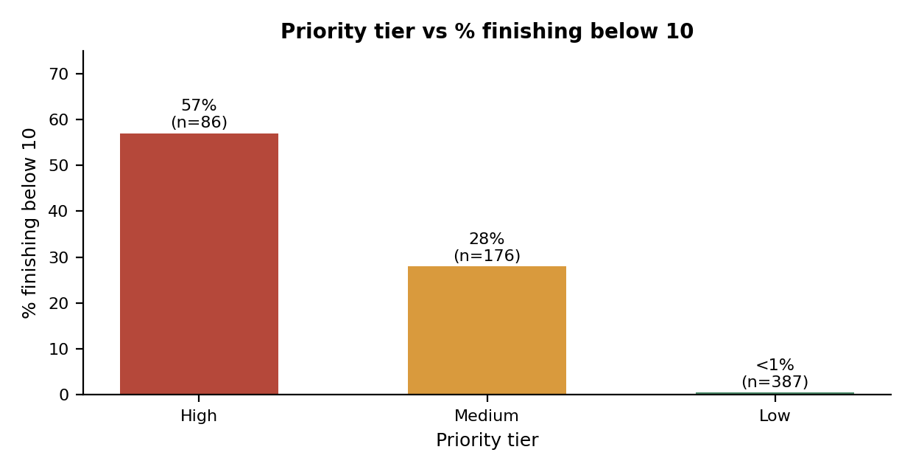

# Milestone 2.2: Final Delivery (Executive Summary)

**Prepared by:** Thavhiwa Khuliso John
**Data:** public student performance dataset (649 learners), not internal programme data

## Bottom line

A simple, transparent points rule using four early signals can order learners for supportive check-ins. **86 learners** fall in the High tier, and **57%** of them finished below 10, versus under 1% in the Low tier. It should be used as a conversation starter for facilitators, not as a verdict on any learner.

## What was asked

A structured way to decide where facilitator attention is needed first, without profiling learners by demographics or family background, and without using final results.

## What the data shows

1. First-period grade (G1) is the strongest early signal: 56% of learners with G1 below 10 finished below 10, versus 6% at 10 to 11 and none at 12 or more.
2. Past failures matter: about 49% of learners with one or more failures finished below 10, versus 9% with none.
3. Low reported study time shows a steady link (24% versus 6% to 7% at the highest levels).
4. Absences show only a weak link (14% rising to 22%), so they act as a prompt to ask, not a score.

## The rule

| Signal | Rule | Points |
|---|---|---|
| G1 | below 10 / 10 to 11 | 2 / 1 |
| Past failures | 1 or more | 2 |
| Study time | lowest category | 1 |
| Absences | 10 or more | 1 |

**Tiers:** High = 4 or more points, Medium = 2 to 3, Low = 0 to 1.
**Not used:** G2, G3, school support, and all demographic, family and lifestyle fields.

| Tier | Learners | % finishing below 10 |
|---|---|---|
| High | 86 | 57% |
| Medium | 176 | 28% |
| Low | 387 | under 1% |

## Checks we ran

**Grade timing.** G1 catches nearly as many low finishers as G2 but is available a period earlier. G3 was used only to check the rule.

**Fairness audit.** The rule does not use sex, address or school, but it flags some groups more often. These fields were used only for this audit.

| Group | Learners | % flagged High or Medium | % flagged High | % finishing below 10 |
|---|---|---|---|---|
| Girls | 383 | 34% | 12% | 13% |
| Boys | 266 | 49% | 15% | 19% |
| Rural | 197 | 51% | 16% | 22% |
| Urban | 452 | 36% | 12% | 12% |
| School GP | 423 | 30% | 10% | 8% |
| School MS | 226 | 60% | 19% | 30% |

The flag rates mirror real gaps in final outcomes, so the rule is picking up genuine differences, but the data cannot say why they exist. Flags must never be used to label a group, and facilitators should look for shared barriers (for example resources or travel) rather than assume a cause.

**Sensitivity check.**

| Rule | Flagged | Caught | % of low finishers caught | % of flagged who finished low |
|---|---|---|---|---|
| Main rule, High and Medium | 262 | 98 | 98% | 37% |
| Main rule, High only | 86 | 49 | 49% | 57% |
| Equal weights (1 point each), 2 or more | 143 | 69 | 69% | 48% |
| Main rule without absences, 2 or more | 243 | 98 | 98% | 40% |
| G1 below 10 alone | 157 | 88 | 88% | 56% |

Removing absences changes coverage very little (19 fewer flags, the same 98 caught). Equal weights catch fewer low finishers, so weighting G1 and failures more heavily helps. G1 alone catches 88 with 157 flags; the full rule catches 10 more at the cost of 105 extra flags, which is a trade-off for the team.

## Recommendations

1. Use the tiers as a starting list for supportive conversations. Facilitators review every flag and can override it.
2. Start with the High tier (86 learners), then Medium as capacity allows.
3. Match support to the signal: tutoring for low G1 or past failures, a study group for low study time, a friendly check-in about barriers for high absences.
4. Review the cut-offs each term, and look for shared barriers when some groups are flagged more often.
5. Do not add demographic, family or lifestyle fields to the rule, even if they appear to improve it.

## What this data cannot justify

Judging a learner's ability or effort, predicting an individual's result, deciding anyone's access to a programme, or explaining why a learner is struggling. About 6 in 10 flagged High and Medium learners did not finish below 10, so false alarms are expected. The rule was tested on the same data it was built from, so real-world results will likely be weaker.

## Decisions for the programme team

1. Flag High only (86 learners, lower workload, catches 49 of 100) or High and Medium (262 learners, catches 98 of 100)?
2. Keep absences as a conversation prompt, or drop them to cut about 19 flags with no loss of coverage?
3. Pilot the rule with a facilitator group and collect feedback on whether flags were useful.

## Data needed next

The programme's own early data (attendance, assessment scores, engagement), facilitator feedback on flags, and outcomes after support, to test whether the rule helps.

**Workbook sheets:** `Executive_Summary`, `Fairness_Check`, `Sensitivity_Check`
